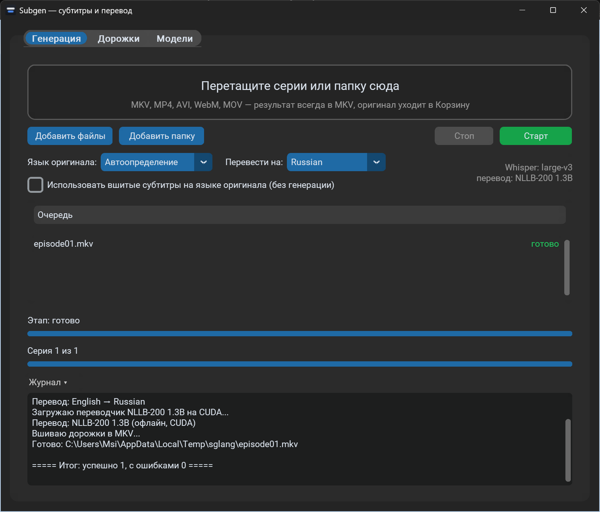

# Subgen

*[Русская версия](README.md)*

Subgen is a Windows app that makes subtitles for videos in the original language (speech is recognized by Whisper, the language is detected automatically), translates them into the language you choose, and muxes both tracks into an MKV file. It is meant for anyone learning a language: an English series with a Russian translation, Japanese anime with English, a German film with Ukrainian, and so on. Drop episodes or a folder onto the window and get an MKV with tracks such as "Japanese (Whisper)" and "English".

The interface is available in ~50 languages. You pick it during installation (default: your Windows language if it is in the list, otherwise English) and can change it on the "Models" tab ("Interface language", applies after a restart). English and Russian are written by hand; the other languages are machine-translated, so some wording may be off.



## Features

- **Subtitles from the audio in the original language.** Whisper detects the spoken language (the log shows which one and how confident it is). If it guesses wrong, set "Source language" manually. Subtitles are always generated by default, even if the file already has some (they are often made before dubbing and do not match the voices). If the embedded subtitles are good, enable "Use embedded subtitles in the source language (no generation)": they are translated instead, and no new original-language track is added.
- **Translation into ~50 languages** ("Translate to:", remembered): Google Translate (online) or offline models that work without the internet. If the source and target languages are the same, nothing is translated.
- **Careful with your file.** Existing tracks (video, audio, other subtitles, fonts) are kept. Subgen tags its own tracks with `SUBGEN=1` and `SUBGEN_ROLE=orig` / `trans` and replaces only them on the next run, for any language pair. Its original-language track becomes the default one. Files processed by older versions (no `SUBGEN_ROLE`) are understood too: the English Subgen track is treated as the original, the others as translations. The result is written to a temporary file, checked with `ffprobe` (duration and stream count), and only then the original goes to the Recycle Bin.
- **Track manager:** title, language, "default" flag, deleting audio and subtitle tracks of any video.
- **Model manager:** choose, download with progress, and delete Whisper and translation models.
- A queue of many episodes, progress with time estimates, a log. Runs on an NVIDIA GPU (CUDA) or on the CPU.

## Requirements

- Windows 10 or 11 (64-bit).
- An NVIDIA GPU is recommended but optional (the CPU is several times slower). A regular driver is enough, no CUDA Toolkit needed.
- Disk space: about 2 GB for the app and libraries plus models (the recommended Whisper large-v3-turbo is 1.5 GB).
- Internet for installation, model downloads and Google Translate.

## Installation

1. Download the project (**Code → Download ZIP** on GitHub and unpack it anywhere) or `git clone https://github.com/LaithsShadow/Subgen.git`.
2. Run **`install.cmd`**, choose the interface language (a number or a code from the list; Enter keeps your Windows language) and wait for "Готово" (done). Non-interactive: `powershell -ExecutionPolicy Bypass -File install.ps1 -Lang en`.

The installer can be re-run safely. It installs [uv](https://docs.astral.sh/uv/) and ffmpeg (`winget`, package `Gyan.FFmpeg`), Python 3.12 managed by uv with an environment in `%LOCALAPPDATA%\Subgen\venv`, the dependencies from `requirements.txt` (about 1.5 GB, mostly CUDA libraries), and creates **Subgen** shortcuts on the desktop and in the Start menu. Models live in `%LOCALAPPDATA%\Subgen\models`, settings (models, target language, `ui_lang`) in `%LOCALAPPDATA%\Subgen\settings.json`. The installer's own messages are in Russian.

## Usage

1. Open **Subgen** (or drop a video or folder onto the shortcut: processing starts right away).
2. Drop episodes or a folder into the window, or use "Add files" / "Add folder".
3. Check "Source language" (usually "Auto-detect") and "Translate to:".
4. Press **Start**. The selected Whisper model is downloaded on first use.

The result is `name.mkv` next to the source (MP4, AVI etc. become MKV); the original goes to the Recycle Bin. No `.srt` files are left next to the video. If muxing fails, for example `name.ja.srt` and `name.en.srt` are saved there so the work is not lost.

**Tracks and languages.** The original track is called "<Language in English> (Whisper)", e.g. "Japanese (Whisper)"; the translation track uses the language's own name: "English", "Deutsch", "日本語". Languages are tagged with ISO 639-2 codes (`eng`, `jpn`, `rus`, `ger`…). With several audio tracks, the one in the selected source language is used; with auto-detect, the default one.

**Embedded subtitles.** With "Auto-detect", the first text subtitle track (not made by Subgen) is used and its language tag becomes the source language. If the track has no language tag, Subgen stops with an error and asks you to choose the source language. With a source language selected, the track in that language is used; if there is none, Whisper generates subtitles.

Console mode:

```
subgen.cmd "D:\Anime\Season 1" [--source auto|ja|en|...] [--target ru|en|de|...] [--embedded] [--model large-v3-turbo] [--translator nllb-1.3b]
```

`--source` defaults to `auto` (Whisper detects it), `--target` defaults to the settings; codes are ISO 639-1 (`en`, `ru`, `ja`, `de`, `zh`…). The old `--embedded-en` flag still works as `--embedded`.

## Models

**Whisper:** large-v3-turbo (1.5 GB) is recommended with an NVIDIA GPU; large-v3 / large-v2 (3 GB) are the most accurate but slower; medium / small for PCs without a GPU; tiny / base to check that everything works. `.en` models understand English only: with them the source language is assumed to be English, and choosing another source language stops with an explanation.

**Translation:**

| Translator | Size | Notes |
|---|---|---|
| Google Translate | — | default; needs the internet, does not work through some VPNs |
| OPUS-MT en→ru | 80 MB | small and very fast; **English → Russian only**, unavailable for other pairs |
| NLLB-200 600M | 600 MB | good quality |
| NLLB-200 1.3B | 1.3 GB | best offline option in our tests |
| MADLAD-400 3B | 2.8 GB | large, needs a GPU |

NLLB models are distributed by Meta under CC-BY-NC 4.0 (non-commercial use only). If Google is unavailable, the translation track is not added and the log shows a warning; the original track is muxed anyway. Turn off the VPN or pick an offline translator and process the file again — Subgen's tracks are replaced. A previous Subgen translation into the same language is kept if translation fails.

## Uninstall

Run **`uninstall.cmd`**: it removes the shortcuts and the Python environment, then asks whether to delete models and settings. uv and ffmpeg stay (remove them with `winget uninstall`).

## For developers

- `subgen/core.py` — processing, `subgen/models.py` — model and language catalog, `subgen/tracks.py` — track manager, `subgen/gui.py` — the window, `subgen/i18n.py` + `subgen/locales/*.json` — UI strings (`t(key, **fields)`, English fallback).
- Edit `en.json` and `ru.json` by hand; regenerate the others with `python tools/gen_locales.py --force [--only de,ja] [--engine google|nllb-1.3b]` and validate with `python tools/gen_locales.py --check`.
- Quick mux and track-manager test without models: `%LOCALAPPDATA%\Subgen\venv\Scripts\python.exe tests\test_mux.py`.

License: MIT.
