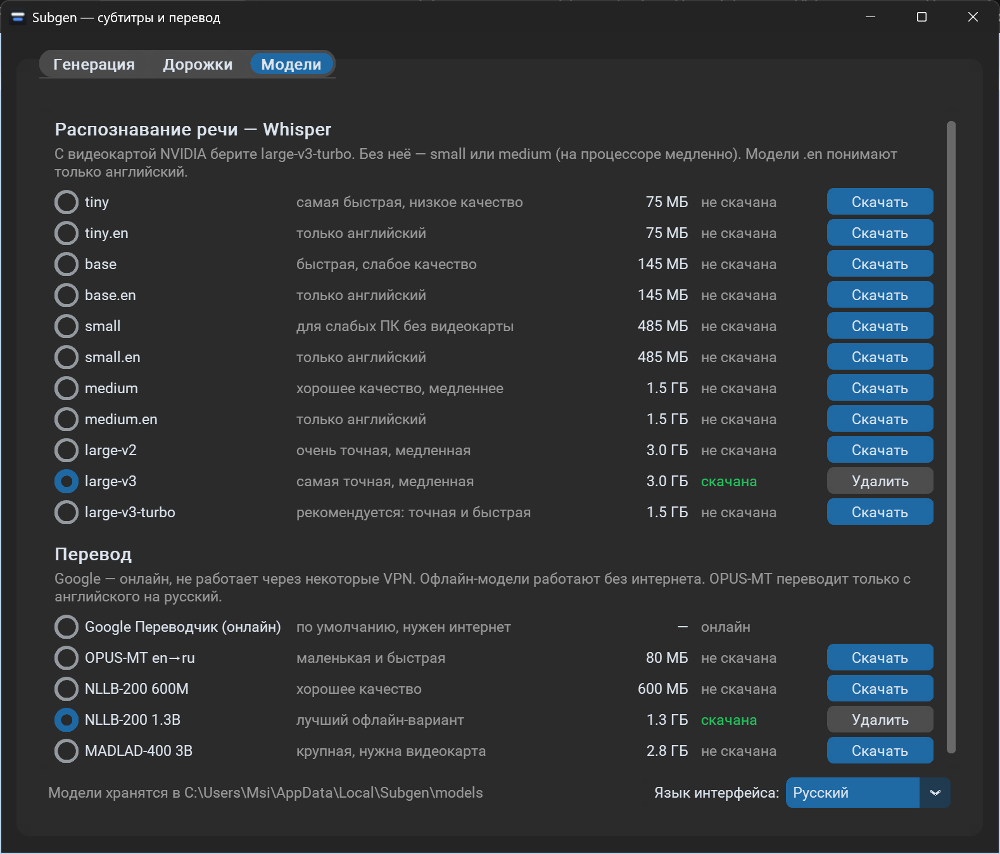
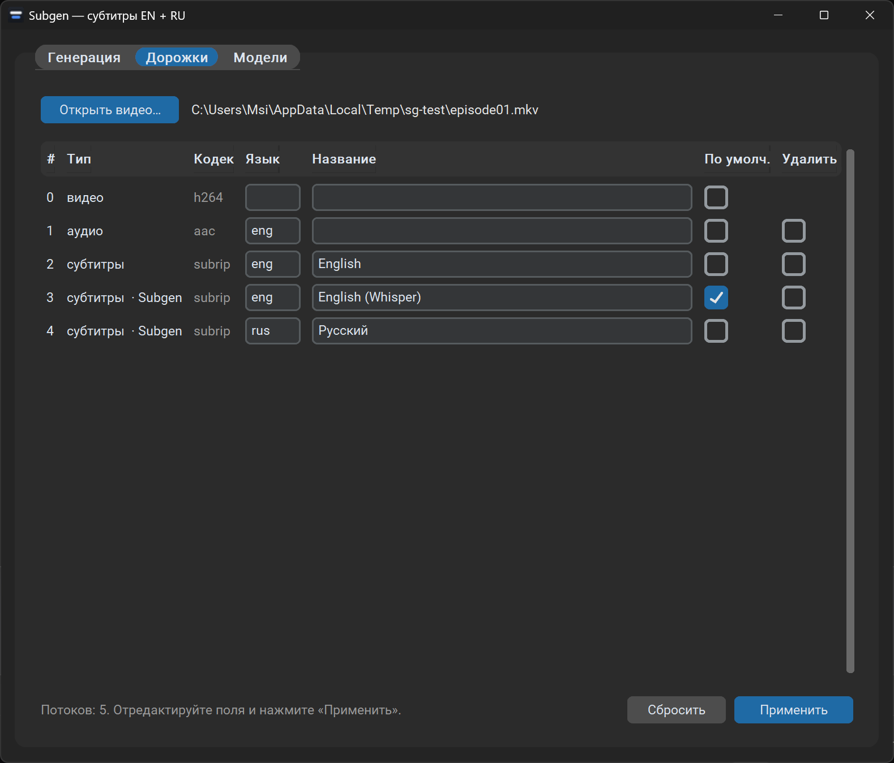

# Subgen

*Video subtitle generator: English subtitles via Whisper, Russian translation, muxed into MKV.*

Subgen — программа для Windows, которая делает к видео английские субтитры (распознаёт речь моделью Whisper) и русский перевод, а затем вшивает обе дорожки в MKV-файл. Удобно для сериалов и аниме с английской озвучкой: перетащили серии или папку — получили MKV с дорожками «English (Whisper)» и «Русский».


## Возможности

- **Английские субтитры по звуку.** По умолчанию всегда генерируются Whisper'ом — даже если в файле уже есть английские субтитры (они часто сделаны до дубляжа и не совпадают с голосами). Если вшитые субтитры подходят, включите «Использовать вшитые английские субтитры (без генерации)»: тогда переводятся они, а новая английская дорожка не добавляется.
- **Русский перевод:** Google Переводчик (онлайн) или офлайн-модели, работающие без интернета.
- **Бережная работа с файлом.** Исходные дорожки (видео, звук, чужие субтитры, шрифты) не удаляются. Свои дорожки программа помечает тегом `SUBGEN=1`, и при повторной обработке заменяет только их. Английская дорожка программы становится основной (по умолчанию), остальные субтитры — нет. Результат сначала пишется во временный файл, проверяется `ffprobe` (длительность и число дорожек), и только потом оригинал уходит в Корзину.
- **Менеджер дорожек:** название, язык, флаг «по умолчанию», удаление звуковых дорожек и субтитров у любого видео.
- **Менеджер моделей:** выбор, скачивание с прогрессом и удаление моделей Whisper и переводчиков.
- Очередь из многих серий, прогресс и оценка оставшегося времени, журнал. Работает на видеокарте NVIDIA (CUDA), а без неё — на процессоре.

## Требования

- Windows 10 или 11 (64-бит).
- Видеокарта NVIDIA — желательно, но не обязательно (без неё распознавание идёт на процессоре, в разы медленнее). Достаточно обычного драйвера, CUDA Toolkit не нужен.
- Место на диске: около 2 ГБ под программу и библиотеки + модели (рекомендуемая Whisper large-v3-turbo — 1,5 ГБ).
- Интернет — для установки, скачивания моделей и перевода через Google.

## Установка

1. Скачайте проект: зелёная кнопка **Code → Download ZIP** на GitHub (распакуйте в любую папку) или
   ```
   git clone https://github.com/Laith-UE5/Subgen.git
   ```
2. Запустите **`install.cmd`** двойным щелчком и дождитесь надписи «Готово».

Что делает установщик (его можно запускать повторно — уже установленное пропускается):

- ставит [uv](https://docs.astral.sh/uv/) — менеджер Python (через `winget`, а если не вышло — официальным скриптом astral.sh);
- ставит ffmpeg через `winget` (пакет `Gyan.FFmpeg`), если его ещё нет;
- скачивает Python 3.12 под управлением uv и создаёт окружение в `%LOCALAPPDATA%\Subgen\venv`;
- устанавливает зависимости из `requirements.txt` (около 1,5 ГБ, в основном библиотеки CUDA);
- создаёт ярлыки **Subgen** на рабочем столе и в меню «Пуск».

Где что лежит:

| Что | Где |
|---|---|
| Код программы | папка, куда вы распаковали проект (ярлыки ссылаются на неё) |
| Окружение Python | `%LOCALAPPDATA%\Subgen\venv` |
| Модели | `%LOCALAPPDATA%\Subgen\models` |
| Настройки (выбранные модели) | `%LOCALAPPDATA%\Subgen\settings.json` |

Если переместили папку с программой — запустите `install.cmd` ещё раз, ярлыки обновятся. Путь может содержать пробелы и кириллицу.

## Использование

1. Откройте **Subgen** (или сразу перетащите видео/папку на ярлык — обработка начнётся сама).
2. Перетащите серии или папку в окно либо нажмите «Добавить файлы» / «Добавить папку».
3. Нажмите **Старт**. При первом запуске скачается выбранная модель Whisper.

Результат — `имя.mkv` рядом с исходником (MP4, AVI и др. превращаются в MKV), оригинал — в Корзине. Отдельные `.srt` рядом не создаются — субтитры только вшиваются в видео (если вшить не удалось, `имя.en.srt` и `имя.ru.srt` сохраняются рядом, чтобы работа не пропала). Если путь к файлу длиннее 250 символов, Корзина такие файлы молча удаляет, поэтому оригинал не удаляется, а переименовывается в `имя.original.ext`.

Консольный режим:

```
subgen.cmd "D:\Аниме\Сезон 1" [--embedded-en] [--model large-v3-turbo] [--translator nllb-1.3b]
```

## Выбор моделей

Вкладка **«Модели»**: выбранная модель запоминается, скачать её можно заранее или она скачается при первой обработке.



**Whisper (распознавание речи):**

| Модель | Размер | Когда брать |
|---|---|---|
| large-v3-turbo | 1,5 ГБ | **рекомендуется**: с видеокартой NVIDIA быстро и точно |
| large-v3 / large-v2 | 3 ГБ | максимальная точность, в несколько раз медленнее turbo |
| medium / small | 1,5 ГБ / 485 МБ | компьютер без видеокарты |
| tiny / base | 75 / 145 МБ | проверить, что всё работает; качество низкое |

Модели с `.en` понимают только английский — чуть точнее на английской речи для размеров tiny…medium.

**Перевод на русский:**

| Переводчик | Размер | Комментарий |
|---|---|---|
| Google Переводчик | — | по умолчанию; нужен интернет, через некоторые VPN не работает |
| OPUS-MT en→ru | 80 МБ | маленький и очень быстрый, качество приличное |
| NLLB-200 600M | 600 МБ | хорошее качество |
| NLLB-200 1.3B | 1,3 ГБ | **лучший офлайн-вариант** по нашим тестам |
| MADLAD-400 3B | 2,8 ГБ | крупная модель, нужна видеокарта (на процессоре медленно) |

Какой переводчик сработал, видно в журнале. Модели NLLB распространяются Meta по лицензии CC-BY-NC 4.0 (только некоммерческое использование).

**Про VPN.** Google Переводчик может быть недоступен через VPN. Тогда русская дорожка не добавляется, а в журнале появляется предупреждение; английская всё равно вшивается. Выключите VPN или выберите офлайн-переводчик и обработайте файл ещё раз — дорожки программы заменятся. Если в файле уже была русская дорожка программы, при сбое перевода она сохраняется.

## Менеджер дорожек

Вкладка **«Дорожки»**: откройте или перетащите видео — появится список всех потоков (номер, тип, кодек, язык, название, флаг «по умолчанию»). Можно переименовать дорожку, сменить язык (трёхбуквенный код: `eng`, `rus`, `jpn`), включить или выключить «по умолчанию», удалить звуковые дорожки и субтитры. Видеодорожки удалить нельзя. После «Применить» файл пересобирается так же безопасно (временный файл → проверка → оригинал в Корзину), и показывается список дорожек нового файла. Дорожки, созданные программой, отмечены «Subgen».



## Решение проблем

- **«Видеокарта (CUDA) не сработала»** — программа сама переключится на процессор. Обновите драйвер NVIDIA; убедитесь, что `install.cmd` завершился без ошибок.
- **«Не найден ffmpeg»** — выполните `winget install --id Gyan.FFmpeg -e` или снова `install.cmd`.
- **«ПЕРЕВОД НЕ УДАЛСЯ»** — см. «Про VPN» выше.
- **«рядом уже есть файл имя.mkv»** — при обработке MP4/AVI рядом уже лежит MKV с тем же именем; программа его не перезаписывает.
- **Модель не скачивается** — проверьте доступ к huggingface.co; прерванная загрузка докачивается при следующей попытке.
- **Ошибка при обработке** — оригинал не трогается; подробности в «Журнале» внизу вкладки «Генерация».

## Удаление

Запустите **`uninstall.cmd`**: удаляются ярлыки и окружение Python, затем программа спросит, удалять ли модели и настройки (`%LOCALAPPDATA%\Subgen`). После этого можно удалить папку с программой. uv и ffmpeg остаются (их можно удалить через `winget uninstall`).

## Для разработчиков

- `subgen/core.py` — обработка (Whisper, перевод, вшивание), `subgen/models.py` — каталог и загрузка моделей, `subgen/tracks.py` — менеджер дорожек, `subgen/gui.py` — окно.
- Быстрая проверка вшивания и менеджера дорожек без моделей: `%LOCALAPPDATA%\Subgen\venv\Scripts\python.exe tests\test_mux.py`.
- Иконка рисуется скриптом `assets/make_icon.py` (Pillow).

Лицензия — MIT.
